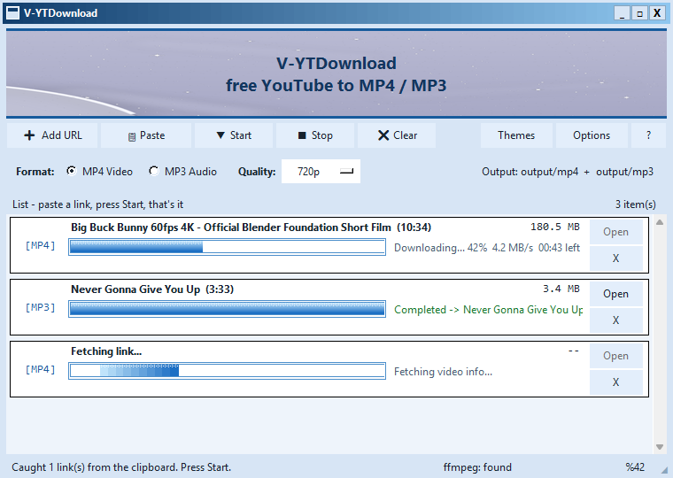
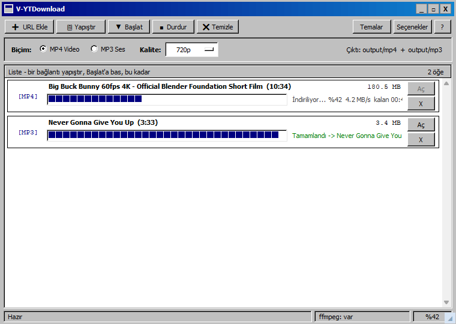
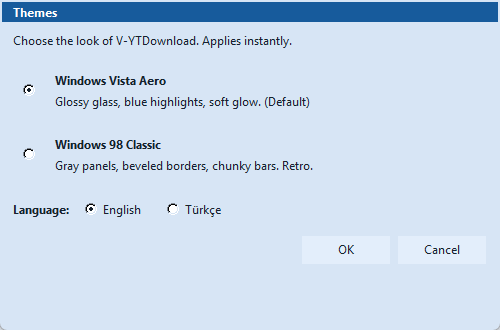

<div align="center">

# ⬇ V-YTDownload

### Free YouTube to MP4 / MP3 downloader for Windows


[](../../releases/latest)

**No Python. No terminal. No setup.** Download the zip, double-click the `.exe`, paste a link, press **Start**.

[⬇ Download latest release](../../releases/latest) · [🐞 Report a bug](../../issues/new) · [💡 Request a feature](../../issues/new)

</div>

---

## 📸 Screenshots

| Windows Vista Aero (default, English) | Windows 98 Classic (Türkçe) |
|---|---|
|  |  |

| Themes & language |
|---|
|  |

## ✨ Features

- 🎬 **YouTube → MP4** (360p / 480p / 720p / 1080p / Best)
- 🎵 **YouTube → MP3** (128k / 192k / 320kbps, via bundled FFmpeg)
- 📋 **Clipboard auto-catch** — copy a link anywhere, it queues itself
- 📃 **Playlist support** — first 25 videos queued automatically
- ⚡ **Self-healing downloads** — Chrome → direct → IPv4 → chunked fallbacks, fully automatic
- 🔑 **YouTube login** — one-click browser cookies or `cookies.txt` for age-restricted videos
- 🎨 **Two themes** — glossy *Windows Vista Aero* or retro *Windows 98 Classic*, switchable instantly
- 🌍 **English + Türkçe**, switchable instantly, remembered after restart
- 📌 **Taskbar icon**, tray-style minimize, Alt+Tab support
- 🧳 **Portable** — settings + downloads live next to the `.exe`

## 🚀 Quick start

1. Download **`V-YTDownload-windows-x64.zip`** from [Releases](../../releases/latest) and extract it anywhere.
2. Double-click **`V-YTDownload.exe`**.
3. Paste a YouTube link → pick **MP4** or **MP3** → press **Start**.
4. Files land in `output/mp4/` and `output/mp3/` next to the exe.

> Your settings (theme, language, login) are stored in `settings.json` beside the exe —
> copy the whole folder to a USB stick and take it with you.

## 🛠 Tech stack

| Piece | Technology |
|---|---|
| Language |  |
| GUI | Tkinter (stdlib, custom-painted Aero/Win98 chrome) |
| Download engine | [yt-dlp](https://github.com/yt-dlp/yt-dlp) (+ `curl-cffi` TLS impersonation) |
| Converter | [FFmpeg](https://ffmpeg.org/) 7.1 (bundled) |
| Packaging | [PyInstaller](https://pyinstaller.org/) (`--windowed`, single folder) |
| i18n | Central `STRINGS` table + instant rebuild (`vyt_core.py`) |

## ❓ FAQ & troubleshooting

<details>
<summary><b>Age-restricted video won't download ("sign in to confirm your age")</b></summary>

Open **Options → YouTube login** and click your browser (Chrome / Edge / Firefox / Brave)
while logged into YouTube there. If the browser blocks the read, close it and retry —
or export a `cookies.txt` (e.g. with the *"Get cookies.txt LOCALLY"* extension) and load it
with the **cookies.txt…** button.

</details>

<details>
<summary><b>SSL / TLS errors (INVALID_SESSION_ID, curl 35)</b></summary>

The app retries automatically (Chrome → direct → IPv4 → chunked) and logs every attempt to
`output/download.log`. If everything dies inside TLS, something on the PC is mangling
handshakes — usually **GoodbyeDPI / Zapret**, a VPN, or an antivirus HTTPS scan.
The app detects running DPI tools and names them on the row — pause that tool and retry.

</details>

<details>
<summary><b>Where do files and settings go?</b></summary>

```text
V-YTDownload.exe
output/mp4/        <- videos
output/mp3/        <- music
output/download.log <- per-attempt diagnostics
settings.json      <- theme, language, login, options
```

If the folder isn't writable, settings fall back to `%APPDATA%\V-YTDownload\`.

</details>

## 🔨 Build from source

<details>
<summary><b>Reproduce the exact release build</b></summary>

```bat
pip install -r requirements.txt
build_exe.bat
```

See [BUILD.md](BUILD.md) for the exact PyInstaller command, the icon-extraction story,
and the full verified-test checklist.

```bat
python app.py          # run from source
```

</details>

## 🗂 Project layout

```text
app.py               # the application (Tkinter, themed, i18n)
vyt_core.py          # themes, EN/TR strings, prefs, frozen-path helpers
assets/              # app.ico (extracted), background.png + generator
screenshots/         # README screenshots
output/              # your downloads (created at runtime, not committed)
BASLAT.bat           # run from source (double-click)
KUR.bat              # install source dependencies
build_exe.bat        # one-command release build
BUILD.md             # build & release documentation
```

## 🙏 Acknowledgments

V-YTDownload is a humble GUI shell — the real heavy lifting is done by these
giants. Respect where respect is due, and consider giving them a ⭐:

| Project | Makers | What they do for us |
|---|---|---|
| **[yt-dlp](https://github.com/yt-dlp/yt-dlp)** | [pukkandan](https://github.com/pukkandan) and [contributors](https://github.com/yt-dlp/yt-dlp/graphs/contributors) | Download engine — extracts, resolves and fetches every video |
| **[FFmpeg](https://ffmpeg.org)** ([mirror](https://github.com/FFmpeg/FFmpeg)) | The [FFmpeg team](https://ffmpeg.org/about.html) | Merging video+audio and converting everything to MP3 |
| **[curl-impersonate / curl_cffi](https://github.com/yifeikong/curl_cffi)** | [yifeikong](https://github.com/yifeikong) and contributors | Real-Chrome TLS fingerprint so downloads survive bot walls |
| **[Pillow](https://github.com/python-pillow/Pillow)** | [hugovk](https://github.com/hugovk) and contributors | Wallpaper art + banner rendering |
| **[PyInstaller](https://pyinstaller.org/)** | [bwoodsend](https://github.com/bwoodsend) and contributors | Turns it all into a single double-clickable `.exe` |

If V-YTDownload ever saved you time, the kindest payback is starring
[yt-dlp](https://github.com/yt-dlp/yt-dlp) and [FFmpeg](https://github.com/FFmpeg/FFmpeg).

## 📄 License

[MIT](LICENSE) — free for personal and commercial use.

---

<details>
<summary><b>🔎 Keywords / SEO tags</b></summary>

> youtube downloader, free youtube downloader, youtube to mp4, youtube to mp3,
> ytmp3, ytmp4, download youtube videos, youtube video downloader windows, youtube mp3
> converter, youtube music downloader, mp4 downloader, mp3 downloader, video downloader,
> windows youtube downloader, youtube downloader for pc, download youtube playlist,
> youtube playlist downloader, 1080p youtube download, 320kbps mp3, mediahuman
> alternative, free mediahuman alternative, retro youtube downloader, windows 98 theme
> app, win98 ui, yt-dlp gui, yt-dlp frontend, ffmpeg mp3 converter, python youtube
> downloader, tkinter youtube downloader, open source youtube downloader, youtube shorts
> downloader, youtube music to mp3, v-ytdownload, vytdownload

`#youtubedownloader` `#youtubetomp3` `#youtubetomp4` `#mp3converter` `#freeDownloader`
`#windows98` `#windowsvista` `#retroUI` `#ytdlp` `#v-ytdownload`

</details>
